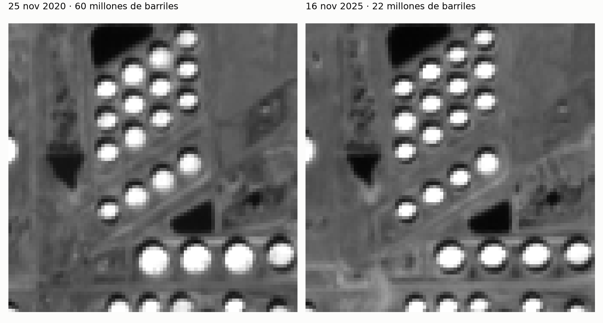
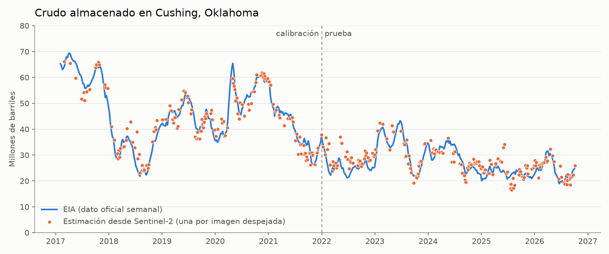
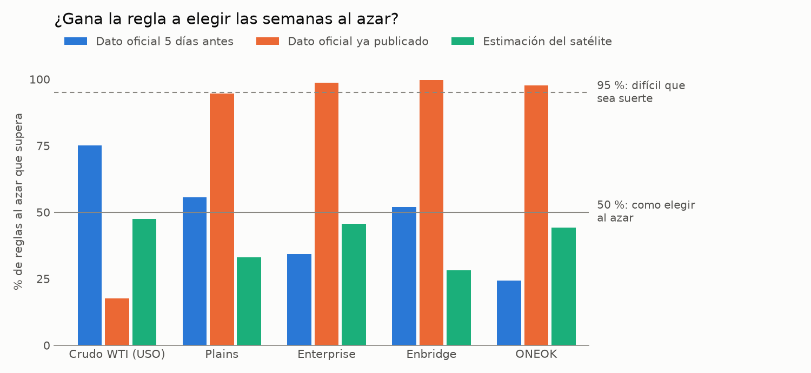

# Petróleo desde el espacio

¿Se puede sacar ventaja en bolsa mirando fotos gratis de un satélite?

Los fondos de inversión lo hacen desde hace años: pagan por imágenes de alta resolución para contar coches en aparcamientos o medir depósitos de petróleo, y así saben cómo va una empresa o un mercado antes de que salga el dato oficial. Este proyecto comprueba hasta dónde se llega con lo que tiene cualquiera: las imágenes públicas de Sentinel-2, donde cada píxel mide 10 metros.

El objetivo es Cushing, Oklahoma. Sus más de 400 tanques guardan el crudo de referencia del mercado americano (el WTI). Cada miércoles el gobierno publica cuánto hay dentro, y ese número mueve el precio del petróleo y de las empresas del sector. Quien lo supiera unos días antes operaría con ventaja.

## La idea

Un tanque de crudo no tiene tapa fija. El techo flota sobre el petróleo y sube y baja con él. Cuando el tanque se vacía, el techo se hunde y la pared proyecta sobre él una sombra con forma de media luna. Cuanto más larga la sombra, menos petróleo.

Si el sol está a una altura `a` sobre el horizonte y la sombra mide `L`, el techo ha bajado `d = L · tan(a)`. Con el diámetro del tanque, eso son barriles.

El problema es que la sombra mide entre 2 y 25 metros y el píxel mide 10. No se puede ver, pero sí se puede deducir: la sombra oscurece un poco los píxeles del borde, y ese poco se puede medir.

## ¿Se puede medir Cushing desde el espacio?

Sí.

La línea azul es el dato oficial de la EIA. Cada punto naranja es una imagen de satélite.

Entre noviembre de 2020 y noviembre de 2025, Cushing pasó de 60 a 22 millones de barriles: una caída del 63 %. Desde el satélite sale un 60 %.

En las imágenes de 2022 a 2026, que no se usaron para calibrar, el error típico es de 3,7 millones de barriles sobre unas existencias de entre 19 y 43 millones. La correlación con el dato oficial en los nueve años es de 0,96.

## ¿Y eso da ventaja para operar?

No. Y no solo porque el satélite se quede corto.

**El satélite no afina lo bastante.** Para adelantarse al dato del miércoles hay que acertar el cambio de una semana, y de una semana a otra Cushing cambia menos de un millón de barriles. El error entre dos imágenes consecutivas es de 2,4 millones: la señal es más pequeña que el ruido. Solo hay imagen nueva la mitad de las semanas, y cuando la hay coincide con el sentido del dato oficial el 63 % de las veces.

**Y aunque afinara, saberlo antes no sirve.** Probé una regla sencilla sobre once años de precios: cada semana, si las existencias suben se compran las empresas dueñas de los tanques (cobran por el espacio alquilado), y si bajan se está fuera. Para el crudo, al revés. La regla se compara con 5.000 versiones de sí misma con las semanas barajadas al azar; si no gana a casi todas, es suerte.

- Conociendo el dato oficial exacto cinco días antes de que se publique (un satélite perfecto), la regla no se distingue del azar.
- Con la estimación real del satélite, tampoco.
- Donde sí aparece algo es con el dato ya publicado: las cuatro empresas lo hacen mejor la semana siguiente a una subida de existencias que tras una bajada, y la regla supera a entre el 95 % y el 100 % de las barajadas. Se mantiene en las dos mitades del periodo y no se explica por un simple rebote del precio.

Ese último resultado hay que leerlo con cuidado. Las cuatro acciones se mueven juntas, así que es un resultado y no cuatro. No incluye comisiones. Y lo encontré después de probar varios días de entrada, lo que siempre favorece encontrar algo. En cualquier caso, para aprovecharlo no hace falta ningún satélite: basta con leer el dato el miércoles.

Lo que limita la medición desde el espacio:

- **Resolución.** En verano el sol está a 70° y las sombras miden menos de 5 metros, medio píxel.
- **Nubes.** De 670 pasadas del satélite, 320 están despejadas. Algunos meses solo hay una o dos imágenes.
- **Tanques pequeños.** Los 52 de menos de unos 36 metros de diámetro no dan píxeles suficientes y se quedan fuera. Los otros 355 suman el 94 % de la capacidad.

## Cómo funciona

1. **Tanques.** La posición y el diámetro de los 407 tanques salen de OpenStreetMap. Con una altura de pared estándar suman 95 millones de barriles de capacidad; la cifra real de Cushing ronda los 94.
2. **Imágenes.** Todas las pasadas de Sentinel-2 sobre Cushing desde 2017 (una cada 5 días). Están en abierto en AWS en un formato que deja descargar solo el recorte de 5 × 11 km en vez de la imagen entera, así que no hace falta cuenta ni clave.
3. **Alineado.** Las imágenes están corridas entre sí hasta 13 metros, más que la sombra que se busca. Se alinean todas contra una de referencia con precisión de medio metro.
4. **Girar hacia el sol.** Cada tanque se recorta y se gira para que el sol quede siempre arriba. Así la sombra cae en el mismo sitio en todos los tanques y todas las fechas.
5. **Ajuste.** Para cada tanque y fecha se dibuja cómo se vería con cada longitud de sombra posible, se emborrona como lo hace la óptica del satélite, y se elige la que más se parece a la imagen real.
6. **Punto cero.** La sombra tiene que ser proporcional a `1/tan(a)` y desaparecer con el sol en lo más alto. Si para un tanque no es así, lo que sobra es el error de posición de ese tanque, y se le resta. Este paso es el que hace que funcione también en verano.

La medición no usa el dato oficial. Solo al final se ajusta una recta para pasar de volumen medido a barriles, con las imágenes anteriores a 2022. Aun así, la prueba de 2022 a 2026 no es del todo ciega: para elegir entre dos versiones del modelo sí comparé con el dato oficial de todo el periodo.

## Tecnologías

Python, por su ecosistema para imágenes de satélite y análisis de datos:

- **pystac-client** y **rasterio** buscan las pasadas de Sentinel-2 y descargan solo el recorte de Cushing de cada imagen, sin bajarla entera.
- **NumPy**, **SciPy** y **scikit-image** alinean las imágenes y ajustan la sombra de cada tanque.
- **pandas** y **matplotlib** cruzan las medidas con el dato oficial, hacen el backtest y dibujan las gráficas.

El proceso está en `src/`, un script por paso, y se repite de principio a fin. Las medidas ya calculadas están en `data/medidas.npz`.

## Datos

- Imágenes: Copernicus Sentinel-2 (ESA), a través de [Earth Search](https://earth-search.aws.element84.com/v1) en AWS.
- Tanques: © colaboradores de [OpenStreetMap](https://www.openstreetmap.org/copyright), licencia ODbL.
- Existencias de crudo: [U.S. Energy Information Administration](https://www.eia.gov/dnav/pet/hist/LeafHandler.ashx?n=PET&s=W_EPC0_SAX_YCUOK_MBBL&f=W).
- Precios: Yahoo Finance, cierres ajustados por dividendos.

La idea de medir Cushing con Sentinel-2 viene de [este vídeo de LosingLoonies](https://www.youtube.com/watch?v=VJm9BBJwMDY). El código y el método de este repositorio son propios.

Esto es un proyecto de programación y análisis de datos, no una recomendación de inversión.
